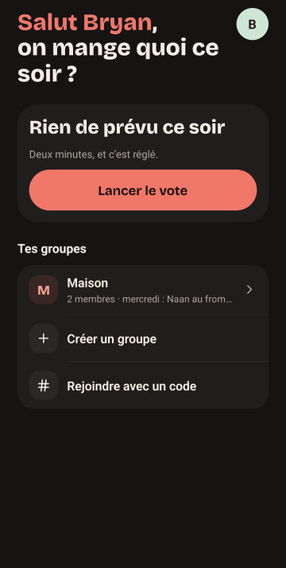
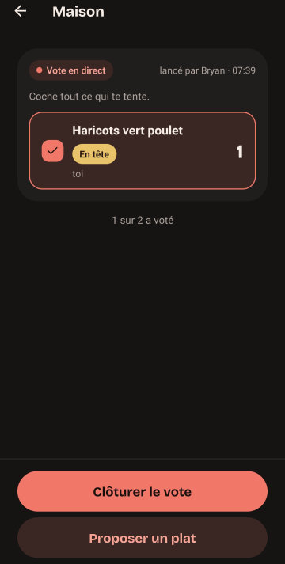
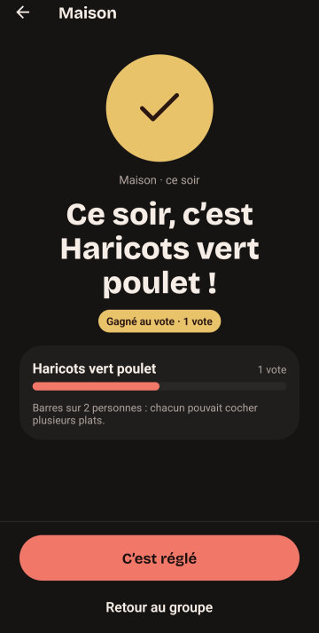
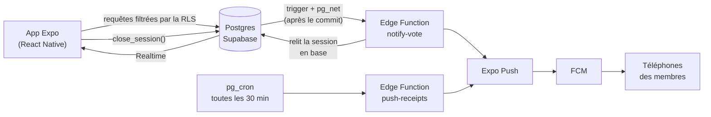

# On mange quoi ?

> De « on mange quoi ? » à « c'est réglé » en moins de 2 minutes.

Application mobile qui sert à décider ensemble du repas du soir. Un membre du foyer lance un vote. Chacun propose des plats et coche tous ceux qui lui conviennent. Le plat qui a le plus de votes gagne. En cas d'égalité, une roulette tranche, et le même plat s'affiche sur tous les téléphones.

**État :** MVP terminé et utilisé chaque soir par mon foyer sur deux téléphones Android (APK distribué avec EAS). Depuis le 19 novembre 2026, je mesure s'il est vraiment adopté avant de passer à la suite (voir [Démarche produit](#démarche-produit)).

| Accueil | Vote en direct | Résultat |
| :---: | :---: | :---: |
|  |  |  |

<p align="center"></p>

## Fonctionnalités

| Parcours | Ce que fait l'app |
| --- | --- |
| Connexion | Code à 6 chiffres reçu par email (OTP), sans mot de passe |
| Groupes | Créer un groupe, inviter avec un code, le quitter (la couronne passe au membre le plus ancien), le supprimer (owner seulement) |
| Vote | Proposer des plats, voter pour plusieurs à la fois (vote par approbation), modifier ses votes jusqu'à la clôture |
| Temps réel | Les votes, les plats proposés et les retraits s'affichent en direct chez tous les membres |
| Résultat | Gagnant calculé par le serveur. Égalité : tirage au sort automatique parmi les ex æquo, personne n'impose son plat |
| Notifications push | Au lancement d'un vote et au résultat. Toucher la notification ouvre le vote |
| Compte | Changer de nom, se déconnecter, supprimer son compte depuis l'app (exigé par Apple) |

## Stack

| Brique | Choix |
| --- | --- |
| App | React Native, TypeScript strict, Expo, Expo Router |
| Backend | Supabase : Postgres, Auth, Realtime, Edge Functions (Deno) |
| Notifications | `expo-notifications`, Expo Push Service, Firebase Cloud Messaging |
| Livraison | EAS Build (APK Android), EAS Update (mises à jour du JavaScript à distance) |
| Qualité | ESLint, Prettier, `node --test`, scénarios SQL sur une base Supabase locale (Docker) |

## Architecture



### Choix techniques

**Le serveur décide, jamais le téléphone.** Le gagnant et le tirage au sort sont calculés dans une fonction SQL (`close_session`), une seule fois, puis enregistrés en base avec la façon dont le gagnant a été désigné (`vote` ou `tirage`). La roulette affichée sur chaque téléphone ne fait que s'arrêter sur ce résultat. Si le tirage avait lieu dans l'app, un membre pourrait le relancer, ou deux téléphones pourraient afficher deux gagnants différents.

**Sécurité dans la base.** La Row Level Security est activée sur toutes les tables : un membre ne lit et n'écrit que dans ses groupes. Les droits `insert` / `update` sont limités aux colonnes que l'app a besoin d'écrire, ce qui bloque l'assignation de masse (impossible de se déclarer gagnant ou owner en ajoutant un champ à la requête). La clé `service_role` n'existe que dans les Edge Functions, jamais dans l'app.

**Concurrence.** Un verrou empêche qu'un vote arrive pendant la clôture. Un index unique partiel garantit une seule session ouverte par groupe. Un script (`npm run db:test:race`) rejoue la course entre un vote et la clôture.

**Notifications déclenchées par la base.** Un trigger appelle l'Edge Function avec `pg_net` quand une session est créée ou clôturée. La requête ne part qu'après le `commit`, et l'app n'a aucun moyen d'envoyer une notification à la place du serveur. La fonction vérifie un secret partagé (stocké dans Supabase Vault, comparé en temps constant), puis relit la session en base au lieu de se fier au corps de la requête. Les reçus d'Expo sont relevés toutes les 30 minutes, et les jetons des téléphones désinstallés sont supprimés.

**Mises à jour à distance sans casser les APK.** EAS Update publie le JavaScript sur les téléphones déjà équipés. La version du runtime est une empreinte du code natif (`fingerprint`) : une mise à jour n'atteint que les APK compatibles, et le build échoue si l'empreinte calculée par EAS diffère de celle du PC.

Le schéma de la base et ses règles sont détaillés dans [`docs/schema.md`](docs/schema.md).

## Tests

| Niveau | Commande | Ce qui est couvert |
| --- | --- | --- |
| Base de données | `npm run db:test` | 8 scripts de scénarios : RLS, droits par colonne, fonctions de groupe, vote et clôture, départ et suppression, jetons push, trigger des notifications, mesure du feu vert |
| Concurrence | `npm run db:test:race` | Vote et clôture lancés en même temps |
| Intégration de l'app | `bash tests/integration/run.sh` | Le vrai `src/lib/votes.ts` contre la base locale : lancer, proposer, voter, clôturer, égalité, tirage, droits de chaque rôle (16 cas) |
| Logique pure | `npm test` | Carte « Ce soir », lien des notifications, messages, tickets et reçus d'Expo |
| Types et style | `npx tsc --noEmit`, `npm run lint`, `npm run format:check` | TypeScript strict, ESLint, Prettier |
| Compatibilité des mises à jour | `bash scripts/check-fingerprint.sh` | L'empreinte runtime n'a pas changé : une mise à jour EAS atteindra les APK installés |

Chaque écran est testé à la main sur un vrai téléphone, et à deux téléphones pour le temps réel et les notifications. Pas encore de tests automatisés des écrans. Les tests d'intégration demandent Supabase en local (`npm run db:start`). La CI les lance sur chaque PR, dans un job séparé qui démarre sa propre base.

## Lancer le projet

Prérequis : Node.js 20+, l'app **Expo Go** sur un téléphone, un projet Supabase.

```bash
npm install
cp .env.example .env   # URL et clé publique du projet Supabase (jamais la clé service_role)
npm run dev            # Expo avec tunnel (indispensable sous WSL), puis scanner le QR code avec Expo Go
```

L'app vise le projet Supabase **en ligne** : un téléphone ne peut pas joindre une base qui tourne sur le PC. Docker sert seulement à écrire et tester les migrations.

Les notifications push ne marchent pas dans Expo Go. Il faut un APK construit avec EAS (`eas build -p android --profile preview`).

### Base de données locale

Prérequis : Docker Desktop (sous Windows, activer l'intégration WSL de la distribution).

| Commande | Effet |
| --- | --- |
| `npm run db:start` | Démarre Supabase en local et applique les migrations |
| `npm run db:reset` | Repart d'une base vide et rejoue toutes les migrations |
| `npm run db:test` | Lance les scénarios de `supabase/scripts/` (chaque ligne : obtenu / attendu) |
| `npm run db:types` | Régénère `src/lib/database.types.ts` après une migration |
| `npm run db:push` | Applique les nouvelles migrations en ligne (lancer `npx supabase db push --linked --dry-run` avant) |
| `npm run db:stop` | Arrête les conteneurs (les données sont conservées) |

## Structure

```
src/app/               écrans et layouts (routes Expo Router)
src/components/        composants partagés (boutons, cartes, roulette…)
src/lib/               accès aux données, temps réel, notifications, logique pure et ses tests
supabase/migrations/   schéma, RLS et fonctions SQL, versionnés
supabase/scripts/      scénarios de test SQL
supabase/functions/    Edge Functions (notify-vote, push-receipts)
docs/                  schéma de la base, journal de bord, backlog
```

## Démarche produit

Chaque version a un **feu vert** mesurable. Tant qu'il n'est pas atteint, j'améliore la version en cours au lieu d'ajouter des fonctionnalités. Celui du MVP se calcule par une fonction SQL (`private.feu_vert`) à partir des votes clôturés.

| Version | Objectif | Feu vert pour passer à la suite |
| --- | --- | --- |
| **MVP · Décider** (en mesure) | Proposer des plats, voter, l'app tranche | Le foyer décide via l'app 4 soirs sur 7, trois semaines de suite |
| V1 · Cuisiner | Recettes, commande groupée, invités sans compte (lien web) | Une soirée à 8+ sans commande passée par WhatsApp |
| V2 · S'inspirer | Import de recettes depuis les réseaux sociaux | Le groupe cuisine régulièrement des recettes importées |
| V3 · Le stock | Stock du foyer, scan code-barres | À définir |
| V4 · Dépenses | Analyse des dépenses et des habitudes | À définir |

Le [journal de bord](docs/journal-de-bord.md) retrace les décisions, les bugs rencontrés et leurs corrections.
