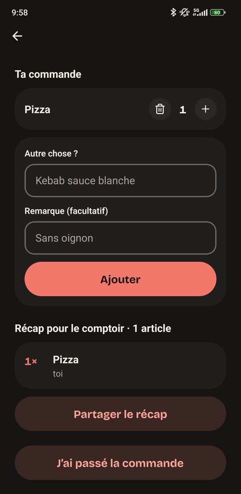
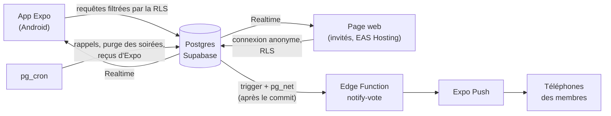

# On mange quoi ?

> De « on mange quoi ? » à « c'est réglé » en moins de 2 minutes.

Application mobile pour décider ensemble de ce qu'on mange, puis passer la commande sans papier ni messages éparpillés.

- **Au quotidien, dans le foyer** : un membre lance un vote, chacun propose des plats et coche tous ceux qui lui vont. Le plat qui a le plus de votes gagne. En cas d'égalité, une roulette tranche, et le même plat s'affiche sur tous les téléphones.
- **En soirée, à plusieurs** : on crée une soirée, on envoie le lien sur WhatsApp, et chacun ajoute sa commande, même sans l'app (depuis un navigateur). Tout le monde voit les commandes en direct, et l'organisateur a le récap prêt pour le comptoir.

**État :** MVP livré et utilisé chaque jour par mon foyer sur deux téléphones Android (APK distribué avec EAS). V1 en cours : les soirées (commande groupée, invités sans compte) sont en ligne depuis le 23 novembre 2026.

| Accueil | Vote en direct | La roulette tranche |
| :---: | :---: | :---: |
|  |  |  |

| Soirée : la commande en direct | Invité sans l'app (navigateur) | Récap partagé sur WhatsApp |
| :---: | :---: | :---: |
|  |  |  |

## Fonctionnalités

| Parcours | Ce que fait l'app |
| --- | --- |
| Connexion | Code à 6 chiffres reçu par email (OTP), sans mot de passe |
| Groupes | Créer un groupe, inviter avec un code, le quitter (l'organisation passe au membre le plus ancien), le supprimer (owner seulement) |
| Vote | Proposer des plats, en cocher plusieurs (vote par approbation), changer d'avis jusqu'à la fin du vote |
| Temps réel | Votes, plats, arrivées et commandes s'affichent en direct chez tous, y compris après une coupure réseau |
| Résultat | Gagnant calculé par le serveur. Égalité : tirage au sort automatique, rejoué en roulette animée sur chaque téléphone |
| Soirées | Créer une soirée, inviter par lien ou par code, choisir le resto (vote ou directement), chacun écrit sa commande, récap pour le comptoir et pour WhatsApp, « J'ai passé la commande » fige tout. Effacée 24 h après |
| Invités sans app | Le lien ouvre une page web : un pseudo, un avatar, et on commande. Si l'app est installée, le lien l'ouvre directement (Android App Links) |
| Notifications push | Au lancement d'un vote, au résultat, et un rappel unique à ceux qui n'ont pas encore participé (entre 10 h et 21 h) |
| Profil | Avatar dessiné ou photo de profil, nom, suppression du compte depuis l'app (exigée par Apple) |
| Confort | Retours haptiques, mode clair et sombre, mises à jour installées toutes seules au retour dans l'app |

## Stack

| Brique | Choix |
| --- | --- |
| App | React Native, TypeScript strict, Expo, Expo Router |
| Web (invités) | La même app exportée pour le web, hébergée sur EAS Hosting |
| Backend | Supabase : Postgres, Auth (OTP et connexion anonyme), Realtime, Storage, Edge Functions (Deno), `pg_cron` |
| Notifications | `expo-notifications`, Expo Push Service, Firebase Cloud Messaging |
| Livraison | EAS Build (APK Android), EAS Update (mises à jour du JavaScript à distance) |
| Qualité | TypeScript strict, ESLint, Prettier, `node --test`, Playwright, CI GitHub Actions |

## Architecture



### Choix techniques

**Le serveur décide, jamais le téléphone.** Le gagnant et le tirage au sort sont calculés dans une fonction SQL (`close_session`), une seule fois, puis enregistrés en base avec la façon dont le gagnant a été désigné. La roulette affichée sur chaque téléphone ne fait que s'arrêter sur ce résultat. Si le tirage avait lieu dans l'app, un membre pourrait le relancer, ou deux téléphones pourraient afficher deux gagnants différents.

**Sécurité dans la base.** La Row Level Security est activée sur toutes les tables : un membre ne lit et n'écrit que dans ses groupes. Les droits `insert` / `update` sont limités aux colonnes que l'app a besoin d'écrire, ce qui bloque l'assignation de masse (impossible de se déclarer gagnant ou owner en ajoutant un champ à la requête). La clé `service_role` n'existe que côté serveur, jamais dans l'app.

**Des invités sans compte, enfermés dans leur soirée.** Un invité se connecte anonymement (Supabase Auth). Les fonctions des foyers refusent tout compte anonyme : avec le code d'un foyer, un invité ne peut pas y entrer. Le lien d'une soirée est un jeton aléatoire, distinct du code à taper dans l'app. Une soirée et ses invités sont effacés 24 h après la commande par une tâche planifiée.

**Le temps réel rattrape ce qu'il a manqué.** Quand on revient de WhatsApp, la connexion Realtime a souvent été coupée. À chaque (re)connexion confirmée, l'écran recharge : une commande ajoutée pendant l'absence apparaît sans quitter l'écran. Un test de bout en bout coupe le WebSocket d'un navigateur pour le vérifier.

**Concurrence.** Un verrou empêche qu'un vote arrive pendant la clôture. Un index unique partiel garantit une seule session ouverte par groupe. Un script (`npm run db:test:race`) rejoue la course entre un vote et la clôture.

**Notifications déclenchées par la base.** Un trigger appelle l'Edge Function avec `pg_net` quand une session est créée ou clôturée ; la requête ne part qu'après le `commit`. La fonction vérifie un secret partagé (Supabase Vault, comparé en temps constant), puis relit la session en base au lieu de se fier au corps de la requête. Les jetons des téléphones désinstallés sont supprimés d'après les reçus d'Expo.

**Photos de profil privées.** Stockage privé : chacun écrit sa photo, seuls les membres de ses groupes la lisent, par lien temporaire. La photo est réduite à 512 px sur le téléphone avant l'envoi, et supprimée avec le compte.

**Mises à jour à distance sans casser les APK.** EAS Update publie le JavaScript sur les téléphones déjà équipés. La version du runtime est une empreinte du code natif (`fingerprint`) : une mise à jour n'atteint que les APK compatibles, et la CI échoue si un changement (une dépendance, un fichier de config) modifie cette empreinte.

Le schéma de la base et ses règles sont détaillés dans [`docs/schema.md`](docs/schema.md).

## Tests

| Niveau | Commande | Ce qui est couvert |
| --- | --- | --- |
| Logique pure | `npm test` | ~70 tests : carte « Ce soir », récap de commande et texte partagé, règles des soirées, file d'envoi des votes, liens et messages des notifications |
| Intégration de l'app | `bash tests/integration/run.sh` | ~90 tests : le vrai code de `src/lib` contre une base locale (vote, égalité, groupes, soirées, invités, photos, rappels, suppression de compte), RLS comprise |
| De bout en bout | `bash e2e/run.sh` | Playwright, deux navigateurs : deux invités rejoignent une soirée par le lien, commandent, voient la commande de l'autre en direct (y compris après une coupure du temps réel) et partagent le récap |
| Base de données | `npm run db:test` | Scénarios SQL : RLS, droits par colonne, vote et clôture, départ et suppression, notifications |
| Concurrence | `npm run db:test:race` | Vote et clôture lancés en même temps |
| Types et style | `npx tsc --noEmit`, `npm run lint`, `npm run format:check` | TypeScript strict, ESLint, Prettier |
| Compatibilité des mises à jour | `bash scripts/check-fingerprint.sh` | L'empreinte runtime n'a pas changé : une mise à jour EAS atteindra les APK installés |

La CI lance tout cela sur chaque PR, avec une base Supabase locale par job. Chaque écran est aussi testé à la main sur deux vrais téléphones (temps réel, notifications, clavier, retours haptiques). Un test qui échoue en CI joint la trace Playwright de chaque navigateur.

## Lancer le projet

Prérequis : Node.js 20+, l'app **Expo Go** sur un téléphone, un projet Supabase.

```bash
npm install
cp .env.example .env   # URL et clé publique du projet Supabase (jamais la clé service_role)
npm run dev            # Expo avec tunnel (indispensable sous WSL), puis scanner le QR code avec Expo Go
```

L'app vise le projet Supabase **en ligne** : un téléphone ne peut pas joindre une base qui tourne sur le PC. Docker sert à écrire et tester les migrations, et aux tests d'intégration et de bout en bout.

Les notifications push, les retours haptiques et la photo de profil demandent un APK construit avec EAS (`eas build -p android --profile preview`).

### Base de données locale

Prérequis : Docker Desktop (sous Windows, activer l'intégration WSL de la distribution).

| Commande | Effet |
| --- | --- |
| `npm run db:start` | Démarre Supabase en local et applique les migrations |
| `npm run db:reset` | Repart d'une base vide et rejoue toutes les migrations |
| `npm run db:test` | Lance les scénarios de `supabase/scripts/` (chaque ligne : obtenu / attendu) |
| `npm run db:types` | Régénère `src/lib/database.types.ts` après une migration |
| `npm run db:push` | Applique les nouvelles migrations en ligne (lancer `npx supabase db push --linked --dry-run` avant) |
| `npm run db:stop` | Arrête les conteneurs (les données sont conservées) |

Tests de bout en bout, la première fois : `npm ci --prefix e2e`, puis `npx --prefix e2e playwright install chromium`.

## Structure

```
src/app/               écrans et layouts (routes Expo Router)
src/components/        composants partagés (boutons, cartes, roulette, commande…)
src/lib/               accès aux données, temps réel, notifications, logique pure et ses tests
supabase/migrations/   schéma, RLS et fonctions SQL, versionnés
supabase/functions/    Edge Functions (notify-vote, push-receipts)
tests/integration/     le code de l'app contre une base locale
e2e/                   tests Playwright (paquet séparé : ne touche pas l'empreinte des APK)
public/                fichiers du site (robots.txt, assetlinks.json pour les App Links)
docs/                  schéma de la base, journal de bord, backlog, politique de confidentialité
```

## Démarche produit

Chaque version a un objectif et un indicateur mesurable. L'indicateur du MVP se calcule par une fonction SQL (`private.feu_vert`) à partir des votes terminés. Depuis le 23 novembre 2026, il ne bloque plus la suite : le projet sert d'abord à construire une app que j'utilise vraiment, et je passe à la version suivante dès que la précédente est livrée et propre.

| Version | Objectif | Indicateur |
| --- | --- | --- |
| **MVP · Décider** (livré) | Proposer des plats, voter, l'app tranche | Le foyer décide via l'app 4 soirs sur 7, trois semaines de suite |
| **V1 · Cuisiner** (en cours) | Soirées et commande groupée (livrées), invités sans compte (livrés), recettes, liste de courses | Une soirée à 8+ sans commande passée par WhatsApp |
| V2 · S'inspirer | Import de recettes depuis les réseaux sociaux | Le groupe cuisine régulièrement des recettes importées |
| V3 · Le stock | Stock du foyer, scan code-barres | À définir |
| V4 · Dépenses | Analyse des dépenses et des habitudes | À définir |

Les décisions produit viennent de l'usage réel : le tirage au sort a remplacé le choix de l'organisateur (vécu comme un passage en force), le rappel unique est né d'un membre qui travaille tard, et le récap reste en texte plutôt qu'en image parce qu'une image ne garde pas le lien cliquable. Le [journal de bord](docs/journal-de-bord.md) retrace ces décisions, les bugs rencontrés et leurs corrections.
