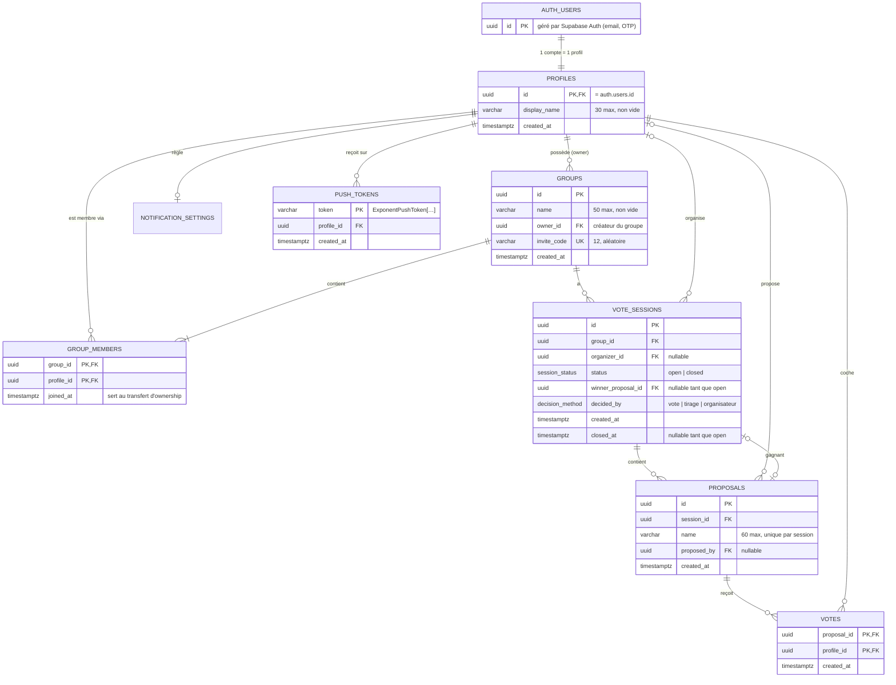

# Schéma de données · MVP Décider et V1 Cuisiner

Base Postgres (Supabase). Les migrations SQL sont dans `supabase/migrations/`.
La Row Level Security est activée sur **toutes** les tables : un membre ne voit que ses groupes.

## Diagramme

**Lire les liens :** `||` = exactement un, `|o` = zéro ou un, `|{` = un ou plusieurs, `o{` = zéro ou plusieurs.
Exemple : `GROUPS ||--|{ GROUP_MEMBERS` = un groupe a au moins un membre (son owner).

## Fiches des tables

Pour chaque clé étrangère, `ON DELETE` dit ce que devient la ligne quand la ligne **pointée** est supprimée :
`cascade` = supprimée aussi · `set null` = gardée, lien vidé · `restrict` = suppression refusée.

### profiles

Infos publiques d'un compte. Email et connexion restent dans `auth.users` (pas de copie : RGPD).

| Colonne | Type | Contraintes |
| --- | --- | --- |
| `id` | `uuid` | PK · FK → `auth.users(id)` `on delete cascade` |
| `display_name` | `varchar(30)` | not null · non vide après `trim` |
| `avatar` | `text` | nullable (null = l'initiale) · `check` dans la liste `chat`, `spaghetti`, `pizza`, `burger`, `avocat`, `ramen` (migration `profile_avatar`) · modifiable par l'app (`grant update (avatar)`), sur son seul profil (RLS) |
| `photo_path` | `text` | nullable · photo perso dans le bucket `avatars`, `<id>/<uuid>.jpg` (`check` : son propre dossier) ; `grant update (photo_path)` (migration `profile_photo`) |
| `is_guest` | `boolean` | not null · default `false` · vrai pour un invité de soirée (profil créé par `join_soiree` depuis un compte anonyme) ; écrit par le serveur seulement (migration `soirees_preview_and_guests`) |
| `created_at` | `timestamptz` | not null · default `now()` |

### groups

Groupe permanent (ex. « Famille »). Chaque repas est une nouvelle session, le groupe n'est jamais recréé.

| Colonne | Type | Contraintes |
| --- | --- | --- |
| `id` | `uuid` | PK · default `gen_random_uuid()` |
| `name` | `varchar(50)` | not null · non vide après `trim` |
| `owner_id` | `uuid` | not null · FK → `profiles(id)` `on delete restrict` |
| `invite_code` | `varchar(12)` | not null · unique · généré côté serveur |
| `created_at` | `timestamptz` | not null · default `now()` |
| `kind` | enum `group_kind` (`foyer`, `soiree`) | not null · default `'foyer'` (migration `soirees`, 2026-11-23) |
| `soiree_step` | enum `soiree_step` (`choix`, `commande`, `passee`) | soirée seulement · changée par les fonctions, jamais par l'app |
| `restaurant` | `varchar(60)` | soirée seulement · fixé par `choose_restaurant` ou gagnant du vote |
| `ordered_at` | `timestamptz` | soirée seulement · « Commande passée », départ des 24 h d'historique |
| `join_token` | `text` | soirée seulement · unique · lien partagé, 128 bits (22 caractères) |
| | | `check groups_kind_check` : un foyer n'a aucune donnée de soirée ; une soirée a une étape et un lien, un resto dès `commande`, `ordered_at` si et seulement si `passee` |

### group_members

Table de jointure profils ↔ groupes. L'owner y figure aussi.

| Colonne | Type | Contraintes |
| --- | --- | --- |
| `group_id` | `uuid` | FK → `groups(id)` `on delete cascade` |
| `profile_id` | `uuid` | FK → `profiles(id)` `on delete cascade` |
| `joined_at` | `timestamptz` | not null · default `now()` |
| | | **PK composée** `(group_id, profile_id)` |

### vote_sessions

Une décision à prendre dans un groupe, lancée par un membre (l'organisateur).

| Colonne | Type | Contraintes |
| --- | --- | --- |
| `id` | `uuid` | PK · default `gen_random_uuid()` |
| `group_id` | `uuid` | not null · FK → `groups(id)` `on delete cascade` |
| `organizer_id` | `uuid` | FK → `profiles(id)` `on delete set null` |
| `status` | enum `session_status` (`open`, `closed`) | not null · default `'open'` |
| `winner_proposal_id` | `uuid` | FK composée `(winner_proposal_id, id)` → `proposals(id, session_id)` `on delete no action` : le gagnant est forcément de cette session et ne peut pas être supprimé |
| `decided_by` | enum `decision_method` (`vote`, `tirage`, `organisateur`) | `organisateur` : sessions d'avant le 2026-11-19 seulement, `close_session` le refuse désormais |
| `reminder_sent_at` | `timestamptz` | nullable · rappel unique déjà envoyé (migration `vote_reminders`) ; écrite seulement par `send_vote_reminders`, aucun droit d'écriture pour l'app |
| `created_at` | `timestamptz` | not null · default `now()` |
| `closed_at` | `timestamptz` | |
| | | **check** : `closed` ⇔ `winner_proposal_id`, `decided_by` et `closed_at` renseignés |

### proposals

Plat soumis au vote, en texte libre.

| Colonne | Type | Contraintes |
| --- | --- | --- |
| `id` | `uuid` | PK · default `gen_random_uuid()` |
| `session_id` | `uuid` | not null · FK → `vote_sessions(id)` `on delete cascade` |
| `name` | `varchar(60)` | not null · non vide après `trim` |
| `proposed_by` | `uuid` | FK → `profiles(id)` `on delete set null` |
| `created_at` | `timestamptz` | not null · default `now()` |
| | | **index unique** `(session_id, lower(trim(name)))` : « Pizza » = « pizza » = « Pizza  » |

### votes

Une ligne = « ce profil a coché ce plat ». Pas de compteur : le score se calcule avec `count(*)`.

| Colonne | Type | Contraintes |
| --- | --- | --- |
| `proposal_id` | `uuid` | FK → `proposals(id)` `on delete cascade` |
| `profile_id` | `uuid` | FK → `profiles(id)` `on delete cascade` |
| `created_at` | `timestamptz` | not null · default `now()` |
| | | **PK composée** `(proposal_id, profile_id)` |

### push_tokens

Une ligne = un téléphone d'un membre, pour les notifications (lancement et résultat d'un vote, MVP depuis le 2026-11-13). Plusieurs téléphones par membre possibles.

| Colonne | Type | Contraintes |
| --- | --- | --- |
| `token` | `varchar(255)` | **PK** · format `ExponentPushToken[…]` ou `ExpoPushToken[…]` (check) |
| `profile_id` | `uuid` | not null · FK → `profiles(id)` `on delete cascade` (RGPD) |
| `created_at` | `timestamptz` | not null · default `now()` |

RLS : chacun **lit et supprime** ses jetons, rien d'autre. Enregistrement par `register_push_token(token)` (`security definer`) : un téléphone partagé change de propriétaire. L'app supprime le jeton **avant** `signOut()` (après, la RLS refuse en silence). L'envoi se fait côté serveur, qui supprime les jetons refusés par Expo (`DeviceNotRegistered`).

**Envoi** (migration `notify_vote_sessions`) : les triggers `notify_vote_session_opened` (`after insert`) et `notify_vote_session_closed` (`after update of status`, seulement `open` → `closed`) appellent l'Edge Function `notify-vote` par `call_edge_function` (`pg_net`), avec l'identifiant de la session. La requête ne part qu'après `commit` et ne fait pas attendre le vote. L'adresse de base des fonctions et le secret partagé sont lus dans **Vault** (`edge_functions_url`, `edge_functions_secret`) : absents (base locale, tests), rien n'est appelé. La fonction relit la session avec la clé `service_role`, prévient les autres membres au lancement et tout le groupe au résultat, supprime les jetons refusés dès le ticket (`DeviceNotRegistered`) et garde les tickets acceptés dans `push_tickets`.

**Rappel unique** (migration `vote_reminders`, 2026-11-20) : `pg_cron` lance `send_vote_reminders()` toutes les 10 minutes (tâche `vote-reminders`). Elle marque `reminder_sent_at` sur chaque vote ouvert depuis 1 à 3 h, pas encore relancé, où un membre (hors organisateur) n'a ni proposé ni voté, entre 10 h et 21 h (Paris), puis appelle `notify-vote` avec l'événement `reminder`. La marque et l'appel sont dans la même transaction : jamais deux rappels pour un vote. `notify-vote` recalcule qui relancer au moment de l'envoi. Réservée à `service_role` (et à `pg_cron`) ; paramètre `reference_time` pour les tests.

### notification_settings

Réglages des notifications d'un membre (migration `notification_settings`, 2026-11-25) : les deux interrupteurs de Mon compte. **Pas de ligne = tout est activé** ; la ligne naît au premier interrupteur touché.

| Colonne | Type | Contraintes |
| --- | --- | --- |
| `profile_id` | `uuid` | **PK** · FK → `profiles(id)` `on delete cascade` (RGPD) |
| `votes` | `boolean` | not null · default `true` · les votes d'un foyer |
| `meals` | `boolean` | not null · default `true` · tout ce qui concerne un repas à plusieurs |
| `shopping` | `boolean` | not null · default `true` · « Je pars faire les courses » et ce que le foyer ajoute pendant ce temps (migration `shopping_trips`) |
| `updated_at` | `timestamptz` | not null · posée par le trigger `notification_settings_touch` |

RLS : chacun **lit, crée et modifie** sa ligne, rien d'autre (une table à part plutôt que des colonnes de `profiles`, lisibles par les co-membres). Droits par colonne : `profile_id`, `votes`, `meals`. `notify-vote` (clé `service_role`) écarte les membres qui ont coupé la catégorie du groupe avant de lire leurs jetons : rien n'est envoyé.

**Résumé d'un repas** (migrations `meal_digest` puis `meal_digest_audiences`, 2026-11-25) : deux vitesses, deux marques sur `groups`. Une arrivée (`group_members`, sauf le responsable à la création) ou un apport (`soiree_contributions`) pose `digest_pending_since` (les autres) et `owner_digest_pending_since` (l'organisateur, sauf pour ses propres actions), au premier changement seulement. `pg_cron` lance `send_meal_digests()` toutes les 30 secondes (tâche `meal-digests`) : **organisateur** dû 1 min après sa marque ; **les autres** dus 10 min après la leur, 30 min au moins après le résumé précédent (`digest_sent_at`) et à partir de 2 nouveautés (`meal_news_count`), sinon le repas reste marqué. Chaque résumé dû est démarqué et l'Edge Function `notify-meal` reçoit le destinataire (`owner` ou `others`) et la fenêtre (du résumé précédent à maintenant). Rien entre 22 h et 8 h (Paris) : les marques restent et tout part à 8 h. `notify-meal` relit la fenêtre et écrit à chacun ce que **les autres** ont fait (« Léa et Tom ont rejoint. Léa apporte : le pain. »), réglage `meals` respecté. Les quatre colonnes ne sont accordées qu'au serveur et restent vides pour un foyer (check). Réservée à `service_role` ; paramètre `reference_time` pour les tests.

**« C'est commandé » et le jour du repas** (migration `meal_ordered_and_day`, 2026-11-25) : le trigger `groups_notify_meal_ordered` (passage à `soiree_step = 'passee'`) appelle `notify-meal` avec `kind = 'ordered'` : les participants sauf le responsable. `pg_cron` lance `send_meal_day_reminders()` toutes les 15 minutes (tâche `meal-day-reminders`) : entre 10 h et 21 h (Paris), chaque repas « maison » dont c'est le jour, créé avant ce jour et pas encore rappelé, reçoit `meal_day_reminded_at` et `notify-meal` est appelée avec `kind = 'meal_day'` (marque et appel dans la même transaction : un seul rappel). Chacun lit ce qu'il apporte. `notify-meal` relit l'état et ignore un événement qui n'est plus vrai.

### meal_notification_mutes

Un repas coupé par un participant (migration `meal_notification_mutes`, 2026-11-25) : l'interrupteur « Me tenir au courant » de l'écran du repas. **Pas de ligne = activé.**

| Colonne | Type | Contraintes |
| --- | --- | --- |
| `group_id`, `profile_id` | `uuid` | **PK** · FK → `group_members(group_id, profile_id)` `on delete cascade` : quitter le repas, en être retiré ou son effacement emportent la ligne |
| `created_at` | `timestamptz` | not null · default `now()` |

RLS : chacun lit, crée et retire les siennes, seulement dans un repas (jamais un foyer). `notify-vote` et `notify-meal` écartent ces membres pour ce groupe (brique commune `reachableTokens`).

### shopping_trips

« Je pars faire les courses » (migration `shopping_trips`, 2026-11-25) : un passage d'un membre d'un foyer, actif 1 h ou jusqu'à « J'ai fini ».

| Colonne | Type | Contraintes |
| --- | --- | --- |
| `id` | `uuid` | **PK** |
| `group_id`, `shopper_id` | `uuid` | not null · FK → `group_members(group_id, profile_id)` `on delete cascade` |
| `started_at` | `timestamptz` | not null · default `now()` |
| `ends_at` | `timestamptz` | not null · default `now() + 1 h` ; « J'ai fini » le ramène à `now()` |
| `announced` | `boolean` | not null · le départ a-t-il été annoncé (pas la nuit, pas deux fois en 30 min) |
| `added_pending_since`, `added_sent_at` | `timestamptz` | ajouts des autres en attente, et dernier envoi |

RLS : visible par le foyer (« Léa est aux courses »), aucune écriture directe. `start_shopping_trip(groupe)` (foyer d'au moins 2 personnes ; un passage en cours est rendu tel quel) et `end_shopping_trip(groupe)`. Le trigger `shopping_trips_notify_started` appelle `notify-shopping` (`kind = 'started'`) si le départ est annoncé : les autres membres. Un article ajouté par quelqu'un d'autre que la personne aux courses pose `added_pending_since` (trigger `shopping_items_mark_addition`) ; `pg_cron` lance `send_shopping_additions()` toutes les 30 secondes (tâche `shopping-additions`) : 30 s après, `notify-shopping` (`kind = 'added'`) envoie à la personne aux courses ce qui reste à prendre. Les passages de plus d'un jour sont effacés. Dans la publication Realtime.

### push_tickets
Ticket d'Expo en attente de son reçu (migration `push_receipts`). Expo répond en deux temps : un ticket tout de suite, un reçu environ 15 min plus tard (gardé 24 h) ; un jeton mort peut n'apparaître que dans le reçu.

| Colonne | Type | Contraintes |
| --- | --- | --- |
| `id` | `text` | **PK** · identifiant du ticket donné par Expo |
| `token` | `varchar(255)` | not null · FK → `push_tokens(token)` `on delete cascade` · index |
| `created_at` | `timestamptz` | not null · default `now()` · index |

RLS activée **sans politique** et aucun droit pour `anon` / `authenticated` : invisible pour l'app, seule la clé `service_role` y accède. **pg_cron** appelle `push-receipts` toutes les 30 min : elle purge les tickets de plus de 24 h, lit les reçus des tickets de plus de 15 min, supprime les jetons `DeviceNotRegistered` (et donc leurs tickets) puis les tickets traités.

### order_items

Une ligne de la commande d'une soirée (migration `soirees`). Texte libre : le catalogue des enseignes viendra plus tard.

| Colonne | Type | Contraintes |
| --- | --- | --- |
| `id` | `uuid` | PK · default `gen_random_uuid()` |
| `group_id` | `uuid` | not null · index |
| `profile_id` | `uuid` | not null · default `auth.uid()` |
| `label` | `varchar(80)` | not null · non vide après `trim` |
| `quantity` | `smallint` | not null · default 1 · entre 1 et 20 |
| `note` | `varchar(120)` | nullable · non vide après `trim` (« sans oignon ») |
| `created_at` | `timestamptz` | not null · default `now()` |
| | | **FK composée** `(group_id, profile_id)` → `group_members` `on delete cascade` : une ligne appartient à un membre ; retiré de la soirée, ses lignes partent |

RLS : les membres lisent toutes les lignes de leur soirée ; chacun ajoute et modifie les siennes ; l'auteur **ou le responsable** supprime. Droits par colonne : `insert (group_id, profile_id, label, quantity, note)`, `update (label, quantity, note)`. Le trigger `order_items_lock_soiree` (`lock_soiree_ordering`, verrou partagé) refuse toute écriture hors de l'étape `commande` avec le hint `ordering_closed` : erreur claire, jamais un filtrage silencieux. Temps réel activé (les DELETE n'y portent que la clé primaire : l'app recharge).

### shopping_items

Un article de la liste de courses d'un foyer (migration `shopping_items`, 2026-11-24). Une liste par groupe, partagée et suivie en direct.

| Colonne | Type | Contraintes |
| --- | --- | --- |
| `id` | `uuid` | PK · default `gen_random_uuid()` |
| `group_id` | `uuid` | not null · FK → `groups` `on delete cascade` · index |
| `label` | `varchar(80)` | not null · non vide après `trim` |
| `quantity` | `varchar(20)` | nullable · non vide après `trim` · texte libre (« 2 », « 500 g ») |
| `added_by` | `uuid` | default `auth.uid()` · FK → `profiles` `on delete set null` |
| `checked_at` | `timestamptz` | nullable · coché = « je l'ai pris » |
| `checked_by` | `uuid` | nullable · FK → `profiles` `on delete set null` · check : `checked_by` non nul seulement si `checked_at` l'est |
| `cleared_at` | `timestamptz` | nullable · rangé par « Retirer les achetés » (migration `shopping_history`) · check : seulement si `checked_at` est rempli · index partiel `where cleared_at is null` |
| `created_at` | `timestamptz` | not null · default `now()` |

RLS : tout membre **d'un foyer** lit, ajoute, coche, modifie et retire (`is_foyer_member` : membre, groupe de `kind = 'foyer'`, compte non anonyme). Une soirée n'a pas de liste. Droits par colonne : `insert (group_id, label, quantity)`, `update (label, quantity, checked_at)` : l'auteur et celui qui coche ne viennent jamais de l'app. Le trigger `shopping_items_stamp_check` pose l'heure du serveur et `auth.uid()` quand on coche, les efface quand on décoche, et garde la première coche si on recoche. « Retirer les achetés » **range** les lignes cochées (`update cleared_at`, heure posée par le trigger) : elles quittent la liste et nourrissent les suggestions « Souvent acheté » ; la croix d'un article, elle, le supprime. Droit par colonne ajouté : `update (cleared_at)`. Temps réel activé (les DELETE n'y portent que la clé primaire : l'app recharge).

## Photo de profil (migration `profile_photo`, 2026-11-23)

Bucket **privé** `avatars` : 1 Mo au plus, `image/jpeg` seulement (contrôlé par Supabase). Un dossier par compte (`<id>/`), un nouveau fichier à chaque envoi (pas de cache périmé), l'ancien supprimé. Règles sur `storage.objects` : envoyer et supprimer dans son seul dossier (jamais un compte anonyme) ; lire, donc créer un lien temporaire, si c'est sa photo ou si `shares_group_with(dossier)` (un groupe ou une soirée en commun). Supabase interdit de supprimer un fichier en SQL (`protect_objects_delete`) : l'app efface ses photos (`removeAllMyPhotos`) **avant** `delete_account`. Réduction à 512 px sur le téléphone (métadonnées et position GPS effacées). Tests : `tests/integration/photos.test.ts`.

## Règles que le schéma seul ne garantit pas

À couvrir par la RLS ou des fonctions, et à tester :

- On ne propose, ne vote et ne retire un vote que si la session est `open`.
- Plats et votes sont **figés à la clôture**, même en cas d'écriture simultanée : les triggers `proposals_lock_open_session` et `votes_lock_open_session` prennent un verrou partagé (`for share`) sur la session, que `close_session` (`for update`) attend avant de compter. Une écriture arrivée après la clôture échoue avec le hint `session_closed`. Rejouer la course : `npm run db:test:race`.
- Une session sans plat ne se clôture pas (`close_session` refuse, décision du 2026-11-05) : l'app désactive le bouton, et n'importe quel membre peut ajouter un plat, donc le groupe n'est jamais bloqué.
- L'auteur ne peut retirer sa proposition que si elle n'a encore reçu aucun vote (personne n'est lésé, rien à notifier).
- Seul l'organisateur (ou l'owner) passe une session à `closed`. Une égalité est toujours tirée au sort ; le choix manuel (`organisateur`) est refusé depuis le 2026-11-19.
- Avant de supprimer un compte owner : transfert au membre le plus ancien (`joined_at`), ou suppression du groupe s'il est seul.
- Organisateur parti (groupe quitté ou compte supprimé) : il ne peut plus clôturer ; l'owner du groupe le peut toujours.
- À la suppression d'un compte, ses propositions **sans vote** dans les sessions **ouvertes** sont supprimées ; les autres restent (`proposed_by` à `null`). Jamais le gagnant d'une session fermée : la base le refuse (FK `no action`).
- Parcours de suppression de compte : prévenir d'abord l'utilisateur (groupes dont il est owner, votes en cours qu'il organise) et lui proposer de choisir à qui transférer ; à défaut, transfert automatique.
- **Droits par colonne** : la RLS choisit les lignes, pas les colonnes. `authenticated` n'a `insert` / `update` que sur les colonnes que l'app écrit (migration `restrict_column_privileges`) ; `id`, `created_at`, `status` et le résultat viennent des défauts et des fonctions. **Toute nouvelle table ou colonne** : révoquer `insert, update` puis accorder colonne par colonne (Supabase accorde tout par défaut).

## Soirées (migration `soirees`, 2026-11-23)

Une soirée est un groupe `kind = 'soiree'` : les invités en deviennent membres, donc la RLS par groupe et le vote marchent tels quels. Étude : https://claude.ai/artifact/7GqZQEu78cCoVNV2refUQ7

| Fonction | Qui | Effet |
| --- | --- | --- |
| `create_soiree(nom)` | vrai compte | soirée à l'étape `choix`, lien tiré, créateur responsable et membre (remplacée le 2026-11-24 : voir « trois façons ») |
| `join_soiree(jeton, pseudo, avatar)` | tout compte, **seule porte d'un anonyme** | crée le profil d'un invité, ajoute le membre ; refus : `invalid_link`, `name_required`, `soiree_closed` (étape `passee`), `soiree_full` (20) |
| `choose_restaurant(soirée, nom)` | responsable | `choix` → `commande` ; refus si un vote est ouvert (`vote_open`) |
| trigger `vote_sessions_open_soiree_ordering` | clôture d'un vote | à l'étape `choix`, le plat gagnant devient le resto et la commande s'ouvre (`close_session` inchangée) |
| `mark_ordered(soirée)` | responsable | `commande` → `passee`, `ordered_at = now()` : lignes et lien figés |
| `purge_soirees(reference_time)` | `pg_cron` (tâche `purge-soirees`, toutes les heures), `service_role` | efface les soirées passées depuis 24 h ou créées depuis 7 jours, puis les comptes anonymes sans groupe (créés depuis plus d'1 h) |

- **Comptes anonymes** (invités) : ils ont le rôle `authenticated`, comme un vrai compte. `is_anonymous_user()` (claim `is_anonymous` du JWT) les refuse dans `create_group`, `join_group`, `create_soiree` et au lancement d'un vote. Ils proposent, votent et commandent dans leur soirée.
- Un vote ne se lance dans une soirée qu'à l'étape `choix` (politique d'insert de `vote_sessions`).
- Responsable qui part : la soirée passe au membre le plus ancien, comme un foyer, même s'il est invité anonyme (il peut alors passer la commande).
- Tests : `tests/integration/soirees.test.ts` (23 cas, contre-épreuve faite sur le blocage des anonymes).
- **Aperçu du lien** (migration `soirees_preview_and_guests`) : `soiree_preview(jeton)`, ouverte au rôle `anon` (le visiteur n'a pas encore de compte) : nom, prénom du responsable, étape, nombre de participants, les 5 premiers (prénom, avatar), « déjà membre ? ». Ni code d'invitation, ni commande, ni votes. Le jeton est le secret.
- **Code d'une soirée** (migration `join_group_soirees`, 2026-11-23) : `join_group(code)` accepte aussi le code d'une soirée (quelqu'un qui a l'app, avec son compte), avec les mêmes refus que le lien : `soiree_closed`, `soiree_full`. Même signature (APK installés).
- Temps réel : `group_members` et `groups` ajoutés à la publication (qui arrive, l'étape qui change). Tests de l'app : `tests/integration/soirees-app.test.ts`.

## Repas à plusieurs, trois façons (migrations `meal_modes_types` et `meal_modes`, 2026-11-24)

Retour d'usage : un repas servait à choisir un dessert chez quelqu'un, pas un resto. Maquette : https://claude.ai/artifact/Y3YUASnGDVfdk6pqzDvk4p

| Élément | Règle |
| --- | --- |
| `groups.soiree_mode` | `commande` (comme avant, valeur des repas existants), `resto`, `maison`. Null pour un foyer |
| `groups.meal_date` | Jour du repas (heure de Paris), aujourd'hui par défaut, au plus 6 mois à l'avance. Null pour les repas d'avant la migration |
| Étapes par type | `commande` : `choix` → `commande` → `passee` ; `resto` et `maison` : `choix` → `decide` (contrainte `groups_kind_check` réécrite) |
| `vote_sessions.topic` | `plat` (foyer, par défaut), `resto` (repas `commande` / `resto`, posé par le trigger `vote_sessions_set_topic`), `apero`, `entree`, `plat`, `dessert` (menu d'un repas `maison`). Jamais écrit par l'app |
| Votes ouverts | Index `vote_sessions_one_open_per_topic` : un vote ouvert **par sujet** (remplace un par groupe) |
| `create_soiree(nom, meal_mode, vote_topics, on_date)` | Remplace `create_soiree(nom)` (même appel possible grâce aux valeurs par défaut). `resto` : le vote du resto s'ouvre ; `maison` : un vote par sujet s'ouvre, sans sujet c'est déjà `decide`. Refus : `invalid_date`, `invalid_topic` (`resto` chez quelqu'un) |
| Fin d'un vote | `open_soiree_ordering` : `commande` comme avant ; `resto` : le gagnant devient le resto, `decide` ; `maison` : `decide` quand plus aucun vote n'est ouvert (`for update` sur le repas : deux votes terminés au même instant ne ratent pas le passage) |
| `choose_restaurant` | `commande` → `commande`, `resto` → `decide`, `maison` : refus `mode_mismatch` |
| Lancer un vote depuis l'app | Foyer, ou repas `commande` / `resto` à l'étape `choix`. Le menu d'un repas `maison` ne s'ouvre que par `create_soiree` |
| `purge_soirees` | Repas commandé depuis 24 h ; repas daté effacé à partir du surlendemain de son jour ; repas sans date : 7 jours après sa création |
| `send_vote_reminders` | Un seul rappel par groupe (le premier vote ouvert), même si un repas `maison` en a plusieurs |

### soiree_contributions

« Qui apporte quoi » d'un repas `maison` : `id`, `group_id`, `profile_id` (défaut `auth.uid()`), `label` `varchar(80)` non vide, `created_at`. FK composée `(group_id, profile_id)` → `group_members` `on delete cascade`. RLS : les membres lisent ; un membre (invité compris) ajoute en son nom, seulement dans un repas `maison` ; l'auteur modifie ; l'auteur **ou le responsable** retire. Droits par colonne : `insert (group_id, label)`, `update (label)`. Temps réel activé.

Tests : `tests/integration/meals.test.ts` (13 cas, contre-épreuve faite sur l'index par sujet, « qui apporte quoi » hors `maison` et l'ancienne règle d'effacement). Les fichiers de tests d'intégration tournent l'un après l'autre (`--test-concurrency=1`) : la purge efface tous les repas de la base locale.

## Mesure du feu vert (schéma `private`)

`private.feu_vert(group_id, date_de_depart)` (migration `feu_vert`) renvoie une ligne par semaine (lundi → dimanche) depuis la date de départ : `semaine`, `soirs` (jours distincts avec au moins un vote **clôturé**, à l'heure de `Europe/Paris`) et `reussie` (`soirs >= 4`). Les semaines sans vote apparaissent avec 0. Les votes clôturés avant la date de départ (tests) sont ignorés. Le schéma `private` n'est pas exposé par l'API et `anon` / `authenticated` n'y ont aucun droit : c'est ma mesure, lancée depuis l'éditeur SQL du tableau de bord, pas un écran de l'app. Tests : `test-feu-vert.sql`.

## Ordre de création des migrations

Une table ne peut référencer qu'une table qui existe déjà :

1. `profiles` → 2. `groups` → 3. `group_members` → 4. enums + `vote_sessions` (sans la FK gagnant) → 5. `proposals` → 6. `votes` → 7. ajout de la FK `vote_sessions.winner_proposal_id` (`alter table`), car les deux tables se référencent mutuellement.

## Texte libre rangé à l'écriture (2026-11-24)

Trigger `tidy_text` (fonction `tidy_text_columns`) sur `groups.name`, `groups.restaurant`, `proposals.name`, `order_items.label` / `note`, `soiree_contributions.label`, `shopping_items.label` / `quantity` et `profiles.display_name` : pas d'espace aux bords, un seul entre les mots (`public.tidy_text`). Côté serveur, pour que l'app, la page web des invités et tout futur client écrivent pareil. Effet utile : « Pizza  Roma » est le doublon de « Pizza Roma » pour l'index anti-doublon des propositions.
