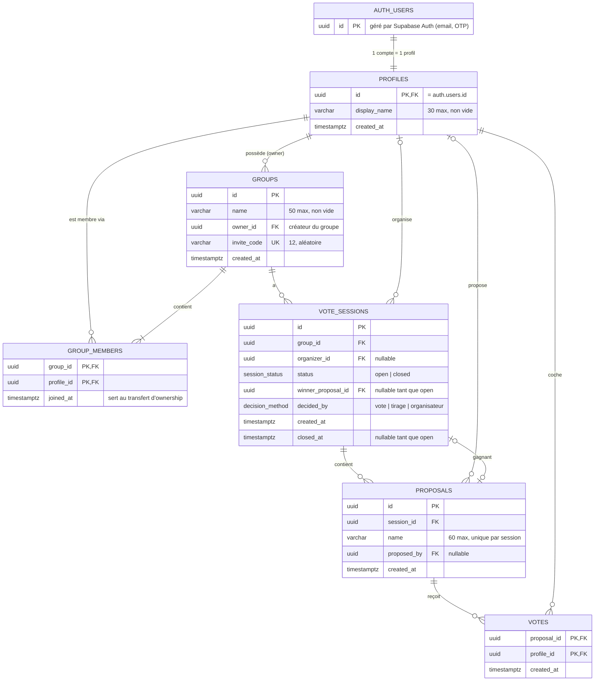

# Schéma de données · MVP Décider

Base Postgres (Supabase). Les migrations SQL sont dans `supabase/migrations/`.
La Row Level Security est activée sur **toutes** les tables : un membre ne voit que ses groupes.

## Diagramme

**Lire les liens :** `||` = exactement un, `|o` = zéro ou un, `|{` = un ou plusieurs, `o{` = zéro ou plusieurs.
Exemple : `GROUPS ||--|{ GROUP_MEMBERS` = un groupe a au moins un membre (son owner).

## Fiches des tables

Pour chaque clé étrangère, `ON DELETE` dit ce que devient la ligne quand la ligne **pointée** est supprimée :
`cascade` = supprimée aussi · `set null` = gardée, lien vidé · `restrict` = suppression refusée.

### profiles

Infos publiques d'un compte. Email et connexion restent dans `auth.users` (pas de copie : RGPD).

| Colonne | Type | Contraintes |
| --- | --- | --- |
| `id` | `uuid` | PK · FK → `auth.users(id)` `on delete cascade` |
| `display_name` | `varchar(30)` | not null · non vide après `trim` |
| `created_at` | `timestamptz` | not null · default `now()` |

### groups

Groupe permanent (ex. « Famille »). Chaque repas est une nouvelle session, le groupe n'est jamais recréé.

| Colonne | Type | Contraintes |
| --- | --- | --- |
| `id` | `uuid` | PK · default `gen_random_uuid()` |
| `name` | `varchar(50)` | not null · non vide après `trim` |
| `owner_id` | `uuid` | not null · FK → `profiles(id)` `on delete restrict` |
| `invite_code` | `varchar(12)` | not null · unique · généré côté serveur |
| `created_at` | `timestamptz` | not null · default `now()` |

### group_members

Table de jointure profils ↔ groupes. L'owner y figure aussi.

| Colonne | Type | Contraintes |
| --- | --- | --- |
| `group_id` | `uuid` | FK → `groups(id)` `on delete cascade` |
| `profile_id` | `uuid` | FK → `profiles(id)` `on delete cascade` |
| `joined_at` | `timestamptz` | not null · default `now()` |
| | | **PK composée** `(group_id, profile_id)` |

### vote_sessions

Une décision à prendre dans un groupe, lancée par un membre (l'organisateur).

| Colonne | Type | Contraintes |
| --- | --- | --- |
| `id` | `uuid` | PK · default `gen_random_uuid()` |
| `group_id` | `uuid` | not null · FK → `groups(id)` `on delete cascade` |
| `organizer_id` | `uuid` | FK → `profiles(id)` `on delete set null` |
| `status` | enum `session_status` (`open`, `closed`) | not null · default `'open'` |
| `winner_proposal_id` | `uuid` | FK → `proposals(id)` |
| `decided_by` | enum `decision_method` (`vote`, `tirage`, `organisateur`) | |
| `created_at` | `timestamptz` | not null · default `now()` |
| `closed_at` | `timestamptz` | |
| | | **check** : `closed` ⇔ `winner_proposal_id`, `decided_by` et `closed_at` renseignés |

### proposals

Plat soumis au vote, en texte libre.

| Colonne | Type | Contraintes |
| --- | --- | --- |
| `id` | `uuid` | PK · default `gen_random_uuid()` |
| `session_id` | `uuid` | not null · FK → `vote_sessions(id)` `on delete cascade` |
| `name` | `varchar(60)` | not null · non vide après `trim` |
| `proposed_by` | `uuid` | FK → `profiles(id)` `on delete set null` |
| `created_at` | `timestamptz` | not null · default `now()` |
| | | **unique** `(session_id, name)` |

### votes

Une ligne = « ce profil a coché ce plat ». Pas de compteur : le score se calcule avec `count(*)`.

| Colonne | Type | Contraintes |
| --- | --- | --- |
| `proposal_id` | `uuid` | FK → `proposals(id)` `on delete cascade` |
| `profile_id` | `uuid` | FK → `profiles(id)` `on delete cascade` |
| `created_at` | `timestamptz` | not null · default `now()` |
| | | **PK composée** `(proposal_id, profile_id)` |

## Règles que le schéma seul ne garantit pas

À couvrir par la RLS ou des fonctions, et à tester :

- Le gagnant (`winner_proposal_id`) appartient à **la même** session.
- On ne propose, ne vote et ne retire un vote que si la session est `open`.
- Seul l'organisateur passe une session à `closed`, et `organisateur` n'est accepté qu'en cas d'égalité.
- Avant de supprimer un compte owner : transfert au membre le plus ancien (`joined_at`), ou suppression du groupe s'il est seul.

## Ordre de création des migrations

Une table ne peut référencer qu'une table qui existe déjà :

1. `profiles` → 2. `groups` → 3. `group_members` → 4. enums + `vote_sessions` (sans la FK gagnant) → 5. `proposals` → 6. `votes` → 7. ajout de la FK `vote_sessions.winner_proposal_id` (`alter table`), car les deux tables se référencent mutuellement.
